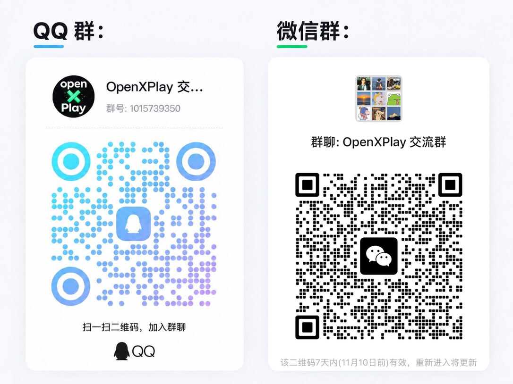

<p align="center"><a href="README.md">English</a> · <b>简体中文</b></p>

# OpenXPlay

**车机装不了软件，也有 CarPlay 的解法。**

OpenXPlay 主要面向**无法在车机上安装第三方软件、但希望使用 CarPlay 的车主**。利用车机已有的浏览器、Carlink 等入口，让 CarPlay 显示在原有车机屏幕上。

你可以把它理解为一套可自由组合的 CarPlay 接入方案：涵盖部分市售 CarPlay 盒子的能力，同时提供更多连接与显示路径，根据车机条件和手头设备选择适合自己的组合。

**本项目提供的技术通过不同组合，最多可形成 28 种解决方案。**

## 两套方案

| | 使用方式 |
| --- | --- |
| **iPhone 直连**（公测） | OpenXPlay iPhone App 让 iPhone 直接连接车机，不需要中继。[加入 TestFlight 公测](https://testflight.apple.com/join/WbKejMWS) |
| **中继** | 由一部安卓手机或 UFI003 随身 Wi-Fi 等小型 Linux 设备连接 iPhone，再把 CarPlay 转给车机。 |

## 连接路线

下图展示 OpenXPlay 的部分连接关系，以 iPhone 直连为主，中继路线为补充。无论选择哪一种显示方式，车机最终显示的都是 CarPlay 画面。



## 追求极致，也追求低成本

让更多车主用上 CarPlay，也让实现它所需的资源更少。

目前，在对应方案与配置下，OpenXPlay 可以做到：

| 指标 | 占用／成本 |
| --- | --- |
| 常驻内存 | **4.3 MB** |
| 磁盘占用 | **5 MB** |
| 硬件成本 | **低至 15 元人民币／3 美元**，不含 MFi 部分 |

*以上数据对应特定的中继方案与运行配置，实际资源占用和成本随所选方案、设备及环境而变化。iPhone 直连不需要额外硬件。*

## 核心特色

- **车机无需安装额外应用**  
  将接收与连接能力交给 iPhone App 或中继，利用车机已有入口显示 CarPlay，无需为了安装接收端应用而修改车机系统。

- **根据现有条件组合方案**  
  整合 Android、Linux 和 iOS 端实现，围绕 USB、蓝牙、Wi-Fi 连接及浏览器、Carlink 等显示方式，提供不同的设备组合与接入路径。

## 让 AI 助手带你安装

[openxplay-guide](skills/openxplay-guide) 技能让 AI 助手带你完成安装：它先问清你的车、iPhone 和手头的设备，推荐一种方案，再一步步带你装好；凡是会改动电脑或设备的操作，都会先征得你同意。

在 [Claude Code](https://claude.com/claude-code) 里发送这句话安装（[Codex](https://github.com/openai/codex) 请换成 `~/.agents/skills/openxplay-guide/`）：

```text
从 https://openxplay.org/agents/skills/index.json 安装 openxplay-guide 技能到 ~/.claude/skills/openxplay-guide/，并核对每个文件的 SHA-256。
```

然后新开一个对话，说“帮我安装 OpenXPlay”。其他能读网页的 AI 助手可以只用一次：让它阅读 <https://openxplay.org/agents/skills/openxplay-guide/SKILL.md> 并按说明操作。每个版本的变化见[更新记录](skills/openxplay-guide/CHANGELOG.md)，更多方式见[开始使用](https://openxplay.org/zh/quick-start#ai-assistant)。

## 与 DiPlay 有什么区别？

**DiPlay 面向能够在车机上安装应用的用户，OpenXPlay 主要面向无法在车机上安装软件的用户。**

| 项目 | 主要使用方式 |
| --- | --- |
| **DiPlay** | 在兼容的 Android 车机上安装应用，由车机直接接收并显示 CarPlay |
| **OpenXPlay** | 由 iPhone App 或中继承接相关能力，借助车机已有的浏览器、Carlink 等入口显示 CarPlay |

两者的侧重点不同。OpenXPlay 希望为无法安装应用的车机提供更多选择，让车主能够利用现有设备找到合适的接入方式。

## 仓库

| 仓库 | 作用 |
| --- | --- |
| [OpenXPlay-Relay](https://github.com/OpenXPlay/OpenXPlay-Relay) | OpenXPlay Relay：Android 应用和 Linux 中继 |
| [OpenXPlay-Stream](https://github.com/OpenXPlay/OpenXPlay-Stream) | 输出到车机接收端：浏览器、Carlink 和投屏 |
| [OpenXPlay-Hardware](https://github.com/OpenXPlay/OpenXPlay-Hardware) | 中继设备的支持文件 |

## 加入交流群

欢迎分享车机适配情况、交流使用体验、反馈问题，参与项目测试与开发。

- **Discord：** <https://discord.gg/j3cKd5Tax>
- **QQ 群：** 1015739350
- **微信群：** 扫描下方二维码

<p></p>

反馈兼容性问题时，请尽量提供车机型号、系统版本、所选方案及问题现象，方便交流与定位。

## 技术来源与许可证

**本项目未对市售 CarPlay 盒子进行逆向工程。**

项目部分 Android 接收能力复用了 DiPlay／xcertplay 相关实现，感谢上游项目及贡献者的工作。

图中字体使用 [MiSans](https://hyperos.mi.com/font/)。

第三方代码、依赖及资产遵循各自的许可证，具体来源与许可信息见各仓库中的许可证和第三方声明文件。

向任何 OpenXPlay 仓库贡献，都须遵循 [OpenXPlay 贡献者许可协议](./CLA.md)（协议文本为英文）。在任意一个仓库的 pull request 里按提示回复一次即可，之后所有仓库的 CLA 检查都会通过。

CarPlay 为 Apple Inc. 的商标。本项目为独立项目，与 Apple 及相关车机、盒子厂商不存在隶属、认可或认证关系。
