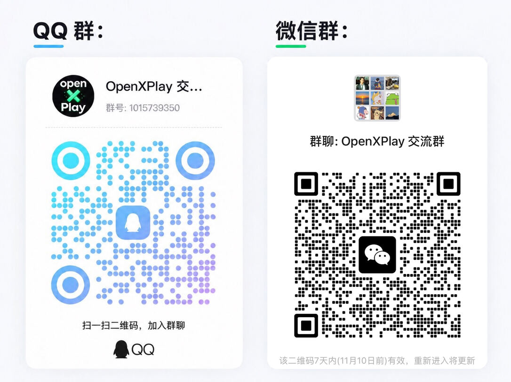

<p align="center"><b>English</b> · <a href="README-zh.md">简体中文</a></p>

# OpenXPlay

**CarPlay for head units that can't install apps.**

OpenXPlay is for drivers who want CarPlay but cannot install third-party apps on their Android head unit. CarPlay shows on the original screen through entry points the head unit already has, such as its browser or a Carlink app.

Think of it as a set of CarPlay building blocks that you combine freely. It covers what some commercial CarPlay boxes do and adds more ways to connect and display, so you can pick the combination that fits your head unit and the devices you have. **Combined, the technologies in this project make up to 28 solutions.**

## Two ways to connect

| | How it works |
| --- | --- |
| **iPhone direct** (beta) | The OpenXPlay iPhone app connects the iPhone to the head unit directly, without a relay. [Join the TestFlight beta](https://testflight.apple.com/join/WbKejMWS) |
| **Relay** | An Android phone or a small Linux device such as a UFI003 dongle connects to the iPhone and passes CarPlay on to the head unit. |

## Connection routes

The diagram shows some of OpenXPlay's connection relationships, with iPhone direct connections emphasized and relay routes shown as alternatives. Whichever display option is selected, the head unit shows the CarPlay interface.



## Lean and low-cost

We want more drivers to have CarPlay, and to need fewer resources to get it. With the matching solution and configuration, OpenXPlay currently achieves:

| Metric | Usage / cost |
| --- | --- |
| Resident memory | **4.3 MB** |
| Disk space | **5 MB** |
| Hardware cost | **From CNY 15 / USD 3**, excluding the MFi part |

*These figures are for a specific relay solution and configuration. Actual usage and cost depend on the solution, devices and environment. iPhone direct needs no extra hardware.*

## Highlights

- **No app on the head unit.** The iPhone app or a relay does the receiving and connecting, and CarPlay appears through entry points the head unit already has. The head unit's system is never modified.
- **Built from what you already have.** Android, Linux and iOS implementations, USB, Bluetooth and Wi-Fi connections, and browser or Carlink display paths combine into different device setups.

## Set up with an AI assistant

The [openxplay-guide](skills/openxplay-guide) skill lets an AI assistant guide your setup. It asks about your car, iPhone and spare devices, recommends a route and walks you through installing it one step at a time, asking before anything that changes your computer or a device.

Install it by sending this message in [Claude Code](https://claude.com/claude-code) (for [Codex](https://github.com/openai/codex), use `~/.agents/skills/openxplay-guide/`):

```text
Install the openxplay-guide skill from https://openxplay.org/agents/skills/index.json into ~/.claude/skills/openxplay-guide/ and check every file’s SHA-256.
```

Then start a new conversation and say “Help me set up OpenXPlay”. Other assistants that can read web pages can use it once: ask them to read <https://openxplay.org/agents/skills/openxplay-guide/SKILL.md> and follow it. Changes are in its [changelog](skills/openxplay-guide/CHANGELOG.md); more options are in [Get started](https://openxplay.org/quick-start#ai-assistant).

## OpenXPlay and DiPlay

**DiPlay is for head units that can install apps; OpenXPlay is mainly for head units that can't.**

| Project | How it is used |
| --- | --- |
| **DiPlay** | Install the app on a compatible Android head unit, which receives and shows CarPlay itself |
| **OpenXPlay** | The iPhone app or a relay does the work, and CarPlay appears through the head unit's existing browser, Carlink app or similar entry points |

The two have different focuses. OpenXPlay gives head units that can't install apps more options, so drivers can find a way in with the devices they already have.

## Repositories

| Repository | Role |
| --- | --- |
| [OpenXPlay-Relay](https://github.com/OpenXPlay/OpenXPlay-Relay) | OpenXPlay Relay: the Android app and the Linux relay |
| [OpenXPlay-Stream](https://github.com/OpenXPlay/OpenXPlay-Stream) | Outputs to head-unit receivers: browser, Carlink and screen casting |
| [OpenXPlay-Hardware](https://github.com/OpenXPlay/OpenXPlay-Hardware) | Support files for relay devices |

## Community

Share how OpenXPlay works with your head unit, swap experiences, report problems, and help test and develop the project.

- **Discord:** <https://discord.gg/j3cKd5Tax>
- **QQ group:** 1015739350
- **WeChat group:** scan the QR code below

<p></p>

When you report a compatibility problem, please include the head unit model, system version, the solution you used and what happened.

## Credits and licenses

**This project did not reverse-engineer commercial CarPlay boxes.**

Parts of the Android receiver reuse code from DiPlay and xcertplay. Thanks to the upstream projects and their contributors.

The diagram uses [MiSans](https://hyperos.mi.com/font/).

Third-party code, dependencies and assets keep their own licenses. See the license and third-party notice files in each repository.

Contributions to every OpenXPlay repository are accepted under the [OpenXPlay Contributor License Agreement](./CLA.md). Accept it once by replying on a pull request to any of them; the CLA check then passes in all of them.

CarPlay is a trademark of Apple Inc. OpenXPlay is an independent project and is not affiliated with, endorsed or certified by Apple or by any head-unit or box maker.
