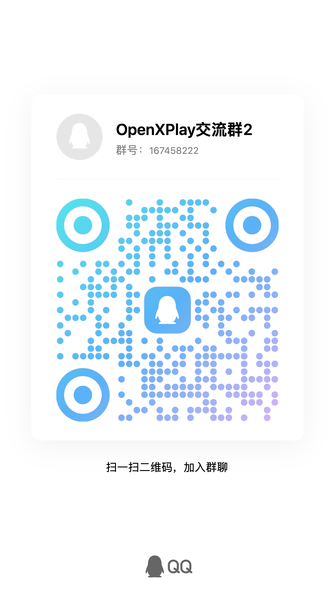

# Community

Share how OpenXPlay works with your head unit, swap experiences, report problems, and help test and develop the project.

## Join {#join}

| Channel | How to join |
| --- | --- |
| QQ group 2 | 167458222, or scan the QR code below |
| WeChat group 4 | Scan the QR code below |
| Discord | [discord.gg/j3cKd5Tax](https://discord.gg/j3cKd5Tax) |

  <figure class="oxp-figure">
    <figcaption>QQ group 2 · 167458222</figcaption>
    
  </figure>
  <figure class="oxp-figure is-wechat">
    <figcaption>WeChat group 4</figcaption>
    
  </figure>

::: details Earlier groups

- **QQ group 1:** Full.
- **WeChat groups 1–3:** By invitation from existing group members only.

:::

WeChat group QR codes expire after a while and are refreshed when they change. If group 4's code has expired, join through QQ or Discord and ask for a new invitation.

## Reporting a problem {#feedback}

When you report a compatibility problem, include the head unit model, its system version, the route you used and what happened. A report from [Check your head unit](/check) helps too. Before asking, have a look at [Troubleshooting](/troubleshooting).

## Sharing your head unit {#share-head-unit}

- Open [Check your head unit](/check) in the head unit’s browser, copy the report and post it with the head unit model and its system version. Reports help other drivers with the same head unit.
- On the Android relay, Settings → Car and screen can copy your head-unit screen data for the developers, so a later release can include your car; see [Choose your car](/daily-use#car-model).

## Contributing {#contribute}

To build OpenXPlay or contribute code, see [Developers](/developers).
