# How it works

OpenXPlay brings an iPhone’s CarPlay to the head unit in one of two ways. Either way, nothing is installed on the head unit and its system is never modified.

- **iPhone direct**: the OpenXPlay iPhone app does the relay’s job on the iPhone itself and connects to the head unit directly. It is in public beta; [join on TestFlight](/en/#iphone-app).
- **Relay**: the iPhone connects to a relay — an Android phone running the OpenXPlay Relay app, or a small Linux device such as the UFI003 USB dongle. The relay acts as the CarPlay receiver and passes video, audio and touch on to the head unit.

<figure class="oxp-figure">
  
  <figcaption>Some of OpenXPlay’s connection routes: iPhone direct, or through an Android or Linux relay. It covers only part of the project’s possible solutions.</figcaption>
</figure>

## Head-unit entry points {#entries}

Today OpenXPlay delivers CarPlay to these head-unit entry points. The relay reaches all of them; the iPhone app reaches the browser, Carlink, CarLife and screen-casting receivers. The links lead to the relay guides.

| Entry point | How it works | Touch | Status |
| --- | --- | --- | --- |
| Browser (web receiver) | H.264 or H.265 video over a secure WebSocket, decoded with WebCodecs | Yes | In development |
| Carlink app | [Over Wi-Fi](/en/carlink) | Yes | In development |
| CarLife | [Over Wi-Fi or USB](/en/carlife) | Yes | Experimental (Android) |
| Screen-casting receivers (DLNA, Miracast) | [Wireless display](/en/wireless-display), operated on the relay phone | No | Experimental (Android) |
| Tesla browser | The [web receiver](/en/tesla) at an address the Tesla browser can open | Yes | Experimental |

## Up to 28 combinations {#combinations}

Think of OpenXPlay as a set of CarPlay building blocks that you combine freely: Android, Linux and iOS implementations; USB, Bluetooth and Wi-Fi connections; and browser or Carlink display paths. It covers what some commercial CarPlay boxes do and adds more ways to connect and display. **Combined, the technologies in this project make up to 28 solutions**, so you can pick the one that fits your head unit and the devices you already have.

## Lean and low-cost {#lean}

| Metric | Usage / cost |
| --- | --- |
| Resident memory | About 2.9 MB (relay) + 1.5 MB (output process) |
| Disk space | About 5 MB |
| Hardware cost | From CNY 15 / USD 3, excluding the MFi part |

The memory and disk figures are a historical measurement from 2026-10-15 on a UFI003: the first development build of the Rust Linux relay, idle with no CarPlay session. These figures are for a specific solution and configuration. Actual usage and cost depend on the solution, the devices and the environment.

## Open source {#open-source}

OpenXPlay’s relays and outputs are open source under AGPL-3.0, and their components talk to each other only through one shared session model. The architecture, repositories and build steps are under [Developers](/en/developers); licences and commercial exemptions are under [Licensing](/en/licensing).
