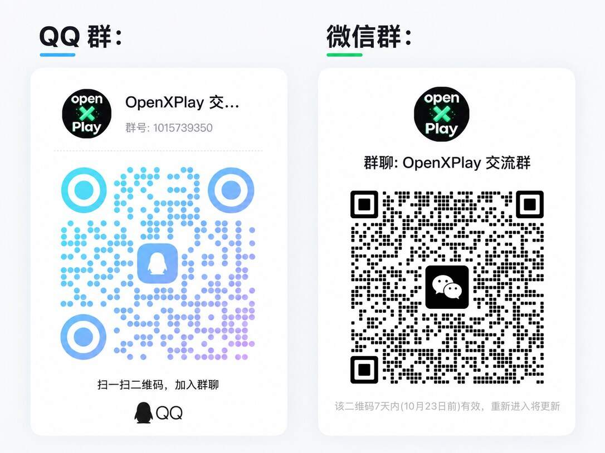

## Who OpenXPlay is for {#who-it-is-for}

OpenXPlay is for drivers who want CarPlay but can’t install third-party apps on their Android head unit. Nothing is installed on the head unit and its system is never modified: a phone or an external device does the receiving and connecting, and CarPlay appears through an entry point the head unit already has.

| Your head unit | What to use |
| --- | --- |
| Can’t install apps | **OpenXPlay**: a phone or external device does the work, and CarPlay appears in the head unit’s browser, its Carlink app or a similar entry point. |
| Can install apps | **[DiPlay](https://github.com/shihabal3amri/DiPlay)**: install the app on a compatible Android head unit, which receives and shows CarPlay itself. |

Developers can build on the same pieces: inputs, outputs and relays that talk to each other only through one shared session model. See [Developers and licensing](/en/developers).

## How the relay route works {#relay-route}

An iPhone connects to a relay — an Android phone running the OpenXPlay Relay app, or a small Linux device such as the UFI003 USB dongle. The relay acts as the CarPlay receiver and passes video, audio and touch on to the head unit.

<figure class="oxp-figure">
  
  <figcaption>One route within OpenXPlay. It covers only part of the project’s possible solutions.</figcaption>
</figure>

Today the relay delivers CarPlay to these head-unit entry points:

| Entry point | How it works | Touch | Status |
| --- | --- | --- | --- |
| Browser (web receiver) | H.264 video over a secure WebSocket, decoded with WebCodecs | Yes | In development |
| Carlink app | Over Wi-Fi | Yes | Experimental |
| Screen-casting receivers (DLNA) | Casting | No | Planned |

## Up to 28 combinations {#combinations}

Think of OpenXPlay as a set of CarPlay building blocks that you combine freely: Android, Linux and iOS implementations; USB, Bluetooth and Wi-Fi connections; and browser or Carlink display paths. It covers what some commercial CarPlay boxes do and adds more ways to connect and display. **Combined, the technologies in this project make up to 28 solutions**, so you can pick the one that fits your head unit and the devices you already have.

## Lean and low-cost {#lean}

| Metric | Usage / cost |
| --- | --- |
| Resident memory | 4.3 MB |
| Disk space | 5 MB |
| Hardware cost | From CNY 15 / USD 3, excluding the MFi part |

These figures are for a specific solution and configuration. Actual usage and cost depend on the solution, the devices and the environment.

## Community {#community}

Share how OpenXPlay works with your head unit, swap experiences, report problems, and help test and develop the project.

| Channel | How to join |
| --- | --- |
| Discord | [discord.gg/j3cKd5Tax](https://discord.gg/j3cKd5Tax) |
| QQ group | 1015739350, or scan the QR code below |
| WeChat group | Scan the QR code below |

<figure class="oxp-figure is-narrow">
  
  <figcaption>WeChat group QR codes expire after a while, so this image is refreshed whenever the code changes. If it has expired, join through QQ or Discord and ask for a new invitation.</figcaption>
</figure>

When you report a compatibility problem, include the head unit model, its system version, the route you used and what happened. A report from [Check your head unit](/en/check) helps too.
