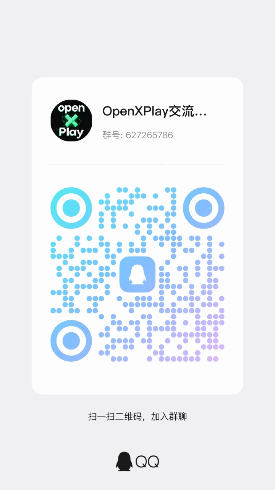

# Comunidad

Cuenta cómo funciona OpenXPlay con tu unidad principal, comparte experiencias, reporta problemas y ayuda a probar y desarrollar el proyecto.

## Únete {#join}

| Canal | Cómo unirte |
| --- | --- |
| Grupo de QQ | 627265786, o escanea el código QR de abajo |
| Grupo de WeChat | Escanea el código QR de abajo |
| Discord | [discord.gg/j3cKd5Tax](https://discord.gg/j3cKd5Tax) |

  <figure class="oxp-figure">
    <figcaption>Grupo de QQ · 627265786</figcaption>
    
  </figure>
  <figure class="oxp-figure is-wechat">
    <figcaption>Grupo de WeChat</figcaption>
    
  </figure>

Los códigos QR de los grupos de WeChat vencen después de un tiempo y se actualizan cuando cambian. Si el código ya venció, únete por QQ o Discord y pide una nueva invitación.

## Reportar un problema {#feedback}

Cuando reportes un problema de compatibilidad, incluye el modelo de la unidad principal, la versión de su sistema, la ruta que usaste y qué pasó. Un informe de [Verifica tu unidad principal](/es/check) también ayuda. Antes de preguntar, revisa [Solución de problemas](/es/troubleshooting).

## Compartir tu unidad principal {#share-head-unit}

- Abre [Verifica tu unidad principal](/es/check) en el navegador de la unidad principal, copia el informe y publícalo con el modelo de la unidad principal y la versión de su sistema. Los informes ayudan a otros conductores con la misma unidad principal.
- En el retransmisor Android, Settings → Car and screen puede copiar los datos de pantalla de tu unidad principal para los desarrolladores, para que una versión posterior incluya tu auto; consulta [Elige tu auto](/es/daily-use#car-model).

## Contribuir {#contribute}

Para compilar OpenXPlay o contribuir con código, consulta [Desarrolladores](/es/developers).
