# Cómo funciona

OpenXPlay lleva CarPlay del iPhone a la unidad principal de una de dos formas. En ambos casos no se instala nada en la unidad principal y su sistema nunca se modifica.

- **Conexión directa del iPhone**: la app OpenXPlay para iPhone hace el trabajo del retransmisor en el propio iPhone y se conecta directamente a la unidad principal. Está en beta pública; [únete en TestFlight](/es/#iphone-app).
- **Retransmisor**: el iPhone se conecta a un retransmisor, que puede ser un teléfono Android con la app OpenXPlay Relay o un pequeño dispositivo Linux como el módem USB UFI003. El retransmisor actúa como receptor de CarPlay y pasa el video, el audio y el control táctil a la unidad principal.

<figure class="oxp-figure">
  
  <figcaption>Algunas de las rutas de conexión de OpenXPlay: directo desde el iPhone, o a través de un retransmisor Android o Linux. Solo cubre parte de las soluciones posibles del proyecto.</figcaption>
</figure>

## Entradas de la unidad principal {#entries}

Hoy OpenXPlay entrega CarPlay a estas entradas de la unidad principal. El retransmisor llega a todas; la app para iPhone llega al navegador, Carlink, CarLife y los receptores de transmisión. Los enlaces llevan a las guías del retransmisor.

| Entrada | Cómo funciona | Control táctil | Estado |
| --- | --- | --- | --- |
| Navegador (receptor web) | Video H.264 o H.265 por un WebSocket seguro, decodificado con WebCodecs | Sí | En desarrollo |
| App Carlink | [Por Wi-Fi](/es/carlink) | Sí | En desarrollo |
| CarLife | [Por Wi-Fi o USB](/es/carlife) | Sí | Experimental (Android) |
| Receptores de transmisión (DLNA, Miracast) | [Transmisión inalámbrica](/es/wireless-display), operada en el teléfono retransmisor | No | Experimental (Android) |
| Navegador de Tesla | El [receptor web](/es/tesla) en una dirección que el navegador de Tesla puede abrir | Sí | Experimental |

## Hasta 28 combinaciones {#combinations}

Piensa en OpenXPlay como un conjunto de piezas de CarPlay que combinas libremente: implementaciones para Android, Linux e iOS; conexiones por USB, Bluetooth y Wi-Fi; y rutas de visualización por navegador o Carlink. Cubre lo que hacen algunos adaptadores comerciales de CarPlay y suma más formas de conectar y mostrar. **Combinadas, las tecnologías de este proyecto forman hasta 28 soluciones**, así que puedes elegir la que se adapte a tu unidad principal y a los dispositivos que ya tienes.

## Ligero y económico {#lean}

| Métrica | Uso / costo |
| --- | --- |
| Memoria residente | Unos 2.9 MB (retransmisor) + 1.5 MB (proceso de salida) |
| Espacio en disco | Unos 5 MB |
| Costo del hardware | Desde CNY 15 / USD 3, sin contar la parte MFi |

Las cifras de memoria y disco son una medición histórica del 2026-10-15 en un UFI003: la primera compilación de desarrollo del retransmisor Linux en Rust, inactivo y sin sesión de CarPlay. Estas cifras corresponden a una solución y configuración específicas. El uso y el costo reales dependen de la solución, los dispositivos y el entorno.

## Código abierto {#open-source}

Los retransmisores y las salidas de OpenXPlay son de código abierto bajo AGPL-3.0, y sus componentes se comunican entre sí solo a través de un modelo de sesión compartido. La arquitectura, los repositorios y los pasos de compilación están en [Desarrolladores](/es/developers); las licencias y las exenciones comerciales, en [Licencias](/es/licensing).
