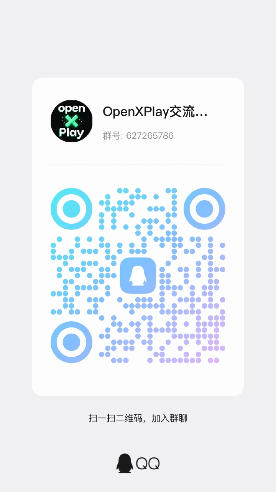
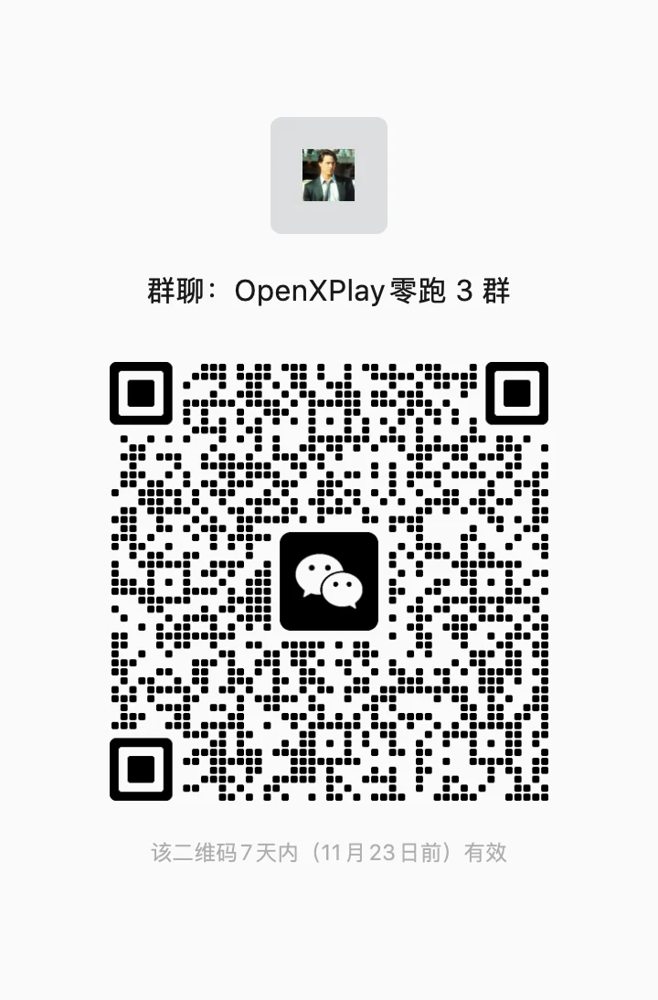

# Сообщество

Расскажите, как OpenXPlay работает с вашим головным устройством, обменивайтесь опытом, сообщайте о проблемах и помогайте тестировать и развивать проект.

## Как присоединиться {#join}

| Канал | Как присоединиться |
| --- | --- |
| Группа QQ | 1095235109 или отсканируйте QR-код ниже |
| Группа WeChat | Отсканируйте QR-код ниже |
| Discord | [discord.gg/j3cKd5Tax](https://discord.gg/j3cKd5Tax) |

  <figure class="oxp-figure">
    <figcaption>Группа QQ · 1095235109</figcaption>
    
  </figure>
  <figure class="oxp-figure is-wechat">
    <figcaption>Группа WeChat</figcaption>
    
  </figure>

QR-коды групп WeChat через некоторое время перестают действовать и обновляются, когда меняются. Если код устарел, присоединяйтесь через QQ или Discord и попросите новое приглашение.

## Как сообщить о проблеме {#feedback}

Сообщая о проблеме совместимости, укажите модель головного устройства, версию его системы, использованный способ подключения и что произошло. Отчёт [Проверки головного устройства](/ru/check) тоже поможет. Прежде чем спрашивать, загляните в раздел [Решение проблем](/ru/troubleshooting).

## Как поделиться данными головного устройства {#share-head-unit}

- Откройте [Проверку головного устройства](/ru/check) в браузере головного устройства, скопируйте отчёт и опубликуйте его вместе с моделью головного устройства и версией его системы. Отчёты помогают другим водителям с таким же головным устройством.
- В ретрансляторе на Android в Settings → Car and screen можно скопировать данные экрана головного устройства для разработчиков, чтобы ваш автомобиль появился в одном из следующих выпусков; см. [Выбор автомобиля](/ru/daily-use#car-model).

## Участие в разработке {#contribute}

Чтобы собрать OpenXPlay или внести свой код, см. [Разработчикам](/ru/developers).
