# Как это работает

OpenXPlay выводит CarPlay с iPhone на головное устройство одним из двух способов. В обоих случаях на головное устройство ничего не устанавливается, а его система никогда не изменяется.

- **Прямое подключение iPhone**: приложение OpenXPlay для iPhone выполняет работу ретранслятора на самом iPhone и подключается к головному устройству напрямую. Оно находится в открытом бета-тестировании; [присоединиться в TestFlight](/ru/#iphone-app).
- **Ретранслятор**: iPhone подключается к ретранслятору — телефону Android с приложением OpenXPlay Relay или небольшому устройству на Linux, например USB-модему UFI003. Ретранслятор работает как приёмник CarPlay и передаёт видео, звук и касания на головное устройство.

<figure class="oxp-figure">
  
  <figcaption>Некоторые способы подключения OpenXPlay: напрямую с iPhone или через ретранслятор на Android или Linux. Здесь показана только часть возможных решений проекта.</figcaption>
</figure>

## Способы вывода на головное устройство {#entries}

Сегодня OpenXPlay выводит CarPlay на головное устройство следующими способами. Ретранслятор поддерживает их все; приложение для iPhone — браузер, Carlink, CarLife и приёмники трансляции. Ссылки ведут к инструкциям для ретранслятора.

| Способ | Как работает | Сенсорное управление | Статус |
| --- | --- | --- | --- |
| Браузер (веб-приёмник) | Видео H.264 или H.265 по защищённому WebSocket, декодирование через WebCodecs | Да | В разработке |
| Приложение Carlink | [По Wi-Fi](/ru/carlink) | Да | В разработке |
| CarLife | [По Wi-Fi или USB](/ru/carlife) | Да | Экспериментально (Android) |
| Приёмники трансляции (DLNA, Miracast) | [Беспроводная трансляция](/ru/wireless-display), управление на телефоне-ретрансляторе | Нет | Экспериментально (Android) |
| Браузер Tesla | [Веб-приёмник](/ru/tesla) по адресу, который может открыть браузер Tesla | Да | Экспериментально |

## До 28 комбинаций {#combinations}

Считайте OpenXPlay набором строительных блоков CarPlay, которые можно свободно сочетать: реализации для Android, Linux и iOS; подключения по USB, Bluetooth и Wi-Fi; вывод через браузер или Carlink. Он покрывает то, что делают некоторые коммерческие CarPlay-адаптеры, и добавляет новые способы подключения и вывода. **Вместе технологии этого проекта дают до 28 решений**, так что вы можете выбрать то, которое подходит вашему головному устройству и устройствам, которые у вас уже есть.

## Экономно и недорого {#lean}

| Показатель | Расход / стоимость |
| --- | --- |
| Резидентная память | Около 2,9 МБ (ретранслятор) + 1,5 МБ (процесс вывода) |
| Место на диске | Около 5 МБ |
| Стоимость оборудования | От 15 юаней / 3 долларов США, без учёта MFi |

Данные о памяти и диске — историческое измерение от 2026-10-15 на UFI003: первая сборка для разработки Linux-ретранслятора на Rust, в режиме простоя без сеанса CarPlay. Эти цифры относятся к конкретному решению и конфигурации. Фактический расход и стоимость зависят от решения, устройств и условий.

## Открытый исходный код {#open-source}

Ретрансляторы и модули вывода OpenXPlay открыты по лицензии AGPL-3.0, а их компоненты взаимодействуют друг с другом только через одну общую модель сеанса. Архитектура, репозитории и порядок сборки описаны в разделе [Разработчикам](/ru/developers); лицензии и коммерческие исключения — в разделе [Лицензии](/ru/licensing).
