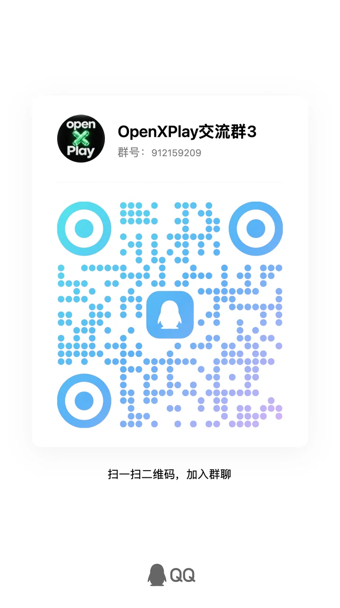

# 交流群

欢迎分享车机适配情况、交流使用体验、反馈问题，参与项目测试与开发。

## 加入 {#join}

| 渠道 | 加入方式 |
| --- | --- |
| QQ 三群 | 912159209，或扫描下方二维码 |
| 微信群 | 扫描下方二维码 |
| Discord | [discord.gg/j3cKd5Tax](https://discord.gg/j3cKd5Tax) |

  <figure class="oxp-figure">
    <figcaption>QQ 三群 · 912159209</figcaption>
    
  </figure>
  <figure class="oxp-figure is-wechat">
    <figcaption>微信群</figcaption>
    
  </figure>

微信群二维码会定期过期，二维码更新后图片也会随之更新。如果二维码已经过期，可以先加入 QQ 群或 Discord，请大家帮忙邀请。

## 反馈问题 {#feedback}

反馈兼容性问题时，请尽量提供车机型号、系统版本、所选方案及问题现象。附上[检测车机](/zh/check)生成的报告也很有帮助。提问前可以先看看[故障排查](/zh/troubleshooting)。

## 分享你的车机 {#share-head-unit}

- 在车机浏览器中打开[检测车机](/zh/check)，复制报告，连同车机型号和系统版本一起发到群里。你的报告能帮助使用同款车机的其他车主。
- 使用安卓中继时，可以在“设置 → 车型与屏幕”中复制车机屏幕数据发给开发者，之后的版本就会自带你的车型数据，见[选择车型](/zh/daily-use#car-model)。

## 参与开发 {#contribute}

想参与构建或贡献代码，请看[开发者](/zh/developers)。
