# 工作原理

OpenXPlay 有两种方式把 iPhone 的 CarPlay 送到车机上。无论哪种方式，车机上都不需要安装任何东西，也不会修改车机系统。

- **iPhone 直连**：OpenXPlay iPhone App 在 iPhone 上完成中继的工作，直接连接车机。目前正在公开测试，可[通过 TestFlight 加入](/zh/#iphone-app)。
- **中继**：iPhone 连接到一台中继：运行 OpenXPlay Relay 应用的安卓手机，或 UFI003 USB 随身 Wi-Fi 这类小型 Linux 设备。中继充当 CarPlay 接收端，再把视频、音频和触控转给车机。

<figure class="oxp-figure">
  
  <figcaption>OpenXPlay 的部分连接路线：iPhone 直连，或经安卓、Linux 中继连接。仅涵盖项目的部分方案组合。</figcaption>
</figure>

## 车机入口 {#entries}

目前，OpenXPlay 可以把 CarPlay 送到这些车机入口。中继支持下表全部入口；iPhone App 支持浏览器、Carlink、CarLife 和投屏接收端。表中链接指向中继的教程。

| 车机入口 | 工作方式 | 触控 | 状态 |
| --- | --- | --- | --- |
| 浏览器（网页接收端） | H.264 或 H.265 视频经安全 WebSocket 传输，由 WebCodecs 解码 | 支持 | 开发中 |
| Carlink 应用 | [经 Wi-Fi 连接](/zh/carlink) | 支持 | 开发中 |
| CarLife | [经 Wi-Fi 或 USB 连接](/zh/carlife) | 支持 | 实验性（安卓） |
| 投屏接收端（DLNA、Miracast） | [无线投屏](/zh/wireless-display)，在中继手机上操作 | 不支持 | 实验性（安卓） |
| 特斯拉浏览器 | [网页接收端](/zh/tesla)，使用特斯拉浏览器能打开的地址 | 支持 | 实验性 |

## 最多 28 种组合 {#combinations}

你可以把 OpenXPlay 理解为一套可自由组合的 CarPlay 接入方案：Android、Linux 和 iOS 端实现，USB、蓝牙和 Wi-Fi 连接，以及浏览器、Carlink 等显示方式。它涵盖部分市售 CarPlay 盒子的能力，同时提供更多连接与显示路径。**本项目提供的技术通过不同组合，最多可形成 28 种解决方案**，你可以根据车机条件和手头设备选择适合自己的组合。

## 极致精简，成本低廉 {#lean}

| 指标 | 占用／成本 |
| --- | --- |
| 常驻内存 | 约 2.9 MB（中继）＋ 1.5 MB（输出进程） |
| 磁盘占用 | 约 5 MB |
| 硬件成本 | 低至 15 元人民币／3 美元，不含 MFi 部分 |

内存和磁盘是 2026 年 10 月 15 日在 UFI003 上测得的历史数据：Rust 版 Linux 中继的第一个开发构建，空闲、没有 CarPlay 会话。以上数据对应特定方案与运行配置，实际资源占用和成本随所选方案、设备及环境而变化。

## 开源 {#open-source}

OpenXPlay 的中继和输出以 AGPL-3.0 开源，组件之间只通过一个共享的会话模型交互。架构、仓库和构建方法见[开发者](/zh/developers)，许可证与商业豁免见[许可证](/zh/licensing)。
